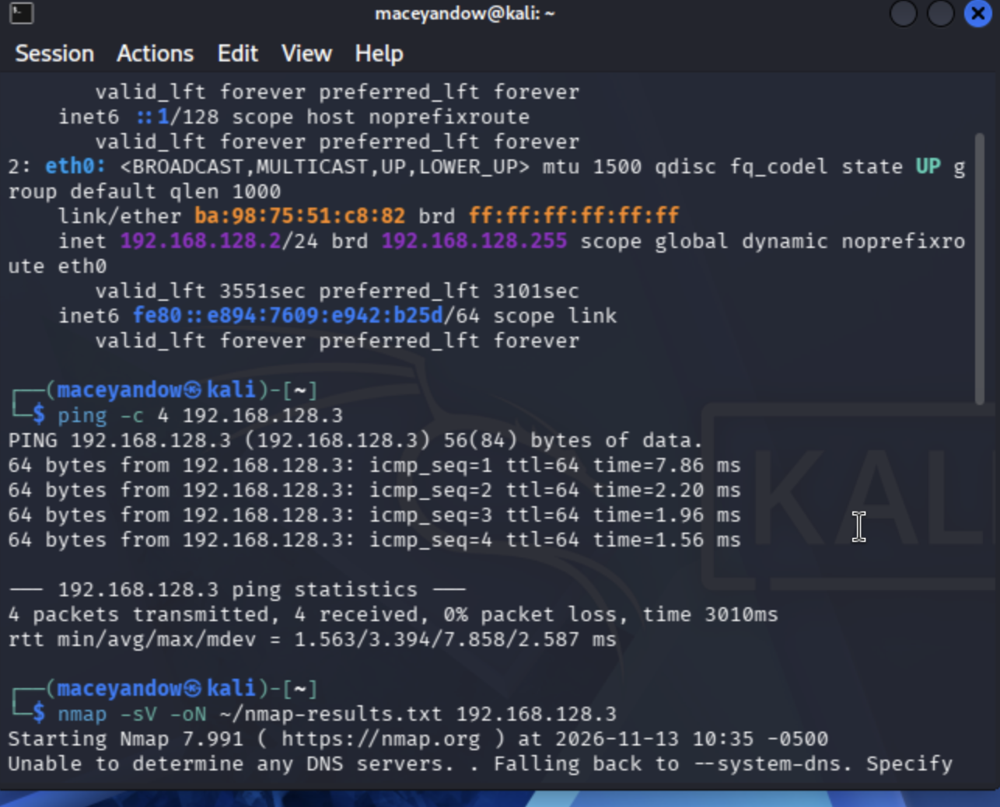
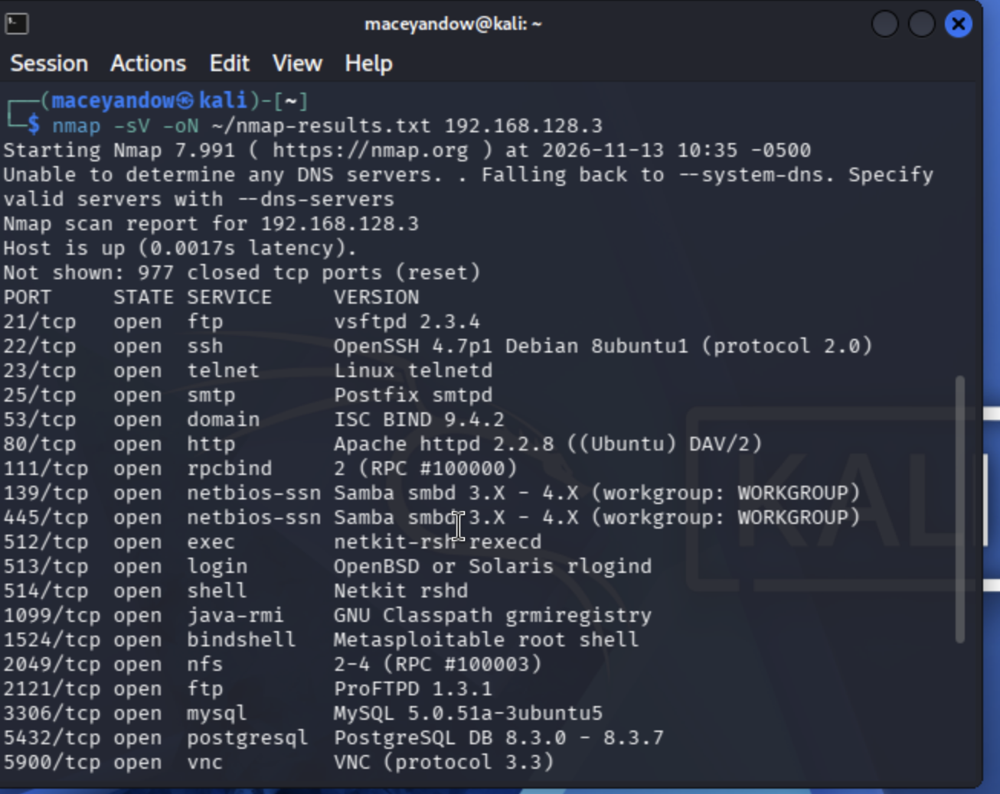
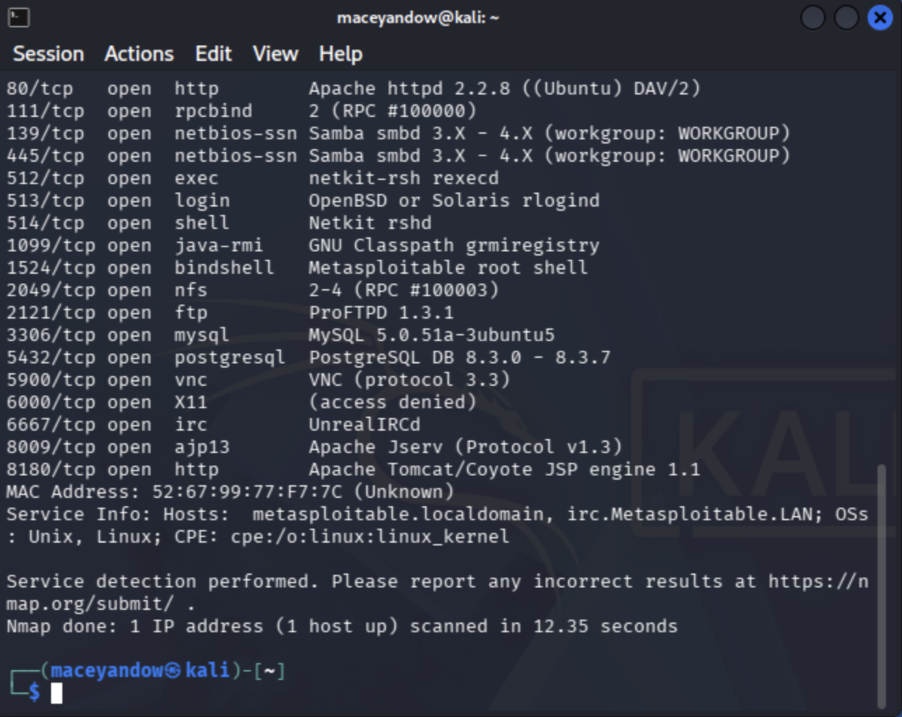

# 01 — Home Lab & Network Scan

## Objective
Build an isolated virtual lab on an Apple Silicon Mac, then use Nmap to discover and assess the services running on a deliberately vulnerable target machine.

> All testing was done in an isolated, host-only virtual network on machines I own. Metasploitable 2 is intentionally vulnerable and was never exposed to the internet or my home/campus network.

## Environment
| Component | Details |
|-----------|---------|
| Host | MacBook Air (M3, 16 GB RAM), macOS Sequoia 15.6.1 |
| Hypervisor | UTM (QEMU) |
| Attacker VM | Kali Linux 2026.3 (ARM64), virtualized at native speed — `192.168.128.2` |
| Target VM | Metasploitable 2 (x86, emulated on an i440FX PC) — `192.168.128.3` |
| Network | UTM **Host Only** network `192.168.128.0/24` — VMs can reach each other, but not the internet |
| Tools | Nmap 7.99, ping, ip / ifconfig |



## Steps

### 1. Built the attacker machine (Kali)
- Downloaded the Kali **ARM64 installer ISO** from kali.org and verified it with SHA-256.
- Created a virtualized Linux VM in UTM (4 GB RAM, 4 cores, 40 GB disk) and installed Kali with the Xfce desktop and default tool set.
- Ran `sudo apt update && sudo apt full-upgrade -y` and took a **"Clean install – updated" snapshot** as a restore point.

### 2. Built the target machine (Metasploitable 2)
- Downloaded Metasploitable 2 from the **official Rapid7 SourceForge project** (not a third-party re-upload).
- Since Metasploitable is x86 and my Mac is ARM, I ran it in UTM's **emulation** mode on an Intel i440FX machine with 1 GB RAM, attaching the provided `Metasploitable.vmdk` as the boot drive.

### 3. Isolated the lab network
- Switched both VMs to **Host Only** networking.
- Confirmed the IPs with `ip a` (Kali) and `ifconfig` (Metasploitable), then tested connectivity:
  ```bash
  ping -c 4 192.168.128.3
  ```
  Result: 4 packets sent, 4 received, 0% packet loss.

### 4. Scanned the target
```bash
nmap -sV -oN ~/nmap-results.txt 192.168.128.3
```
`-sV` detects the software version behind each open port, and `-oN` saves the output to a file.




## Results
Nmap scanned the 1,000 most common ports in **12.35 seconds** and found **23 open ports**. Selected services:

| Port | Service | Version |
|------|---------|---------|
| 21 | FTP | vsftpd 2.3.4 |
| 22 | SSH | OpenSSH 4.7p1 |
| 23 | Telnet | Linux telnetd |
| 80 | HTTP | Apache 2.2.8 |
| 139/445 | SMB | Samba 3.X – 4.X |
| 1524 | bindshell | Metasploitable root shell |
| 3306 | MySQL | MySQL 5.0.51a |
| 5432 | PostgreSQL | PostgreSQL 8.3.0 – 8.3.7 |
| 5900 | VNC | protocol 3.3 |
| 6667 | IRC | UnrealIRCd |

## Findings

### Finding 1 — Unauthenticated root shell (port 1524) — Critical
**What it is:** A "bindshell" listening on port 1524 that gives anyone who connects a root command prompt, with no password.
**Why it matters:** One connection gives an attacker full control of the system. Attackers commonly leave backdoors like this behind after compromising a machine.
**Remediation:** Kill the listening process and remove whatever starts it, block the port at the firewall, and treat the host as compromised: rebuild it from a trusted image.

### Finding 2 — Backdoored FTP server: vsftpd 2.3.4 (port 21) — Critical
**What it is:** This exact version of vsftpd was distributed with a malicious backdoor in 2011 (**CVE-2011-2523**). A specially crafted login opens a root shell on another port.
**Why it matters:** Remote root access with no valid credentials.
**Remediation:** Remove or upgrade vsftpd from a verified source. If file transfer is needed, replace FTP with SFTP over SSH.

### Finding 3 — Backdoored IRC server: UnrealIRCd (port 6667) — Critical
**What it is:** UnrealIRCd 3.2.8.1 was distributed with a backdoor (**CVE-2010-2075**) that allows remote command execution.
**Why it matters:** An attacker can run commands on the server without logging in.
**Remediation:** Remove the IRC service. A server almost never needs one. If it's required, reinstall from a verified source and confirm the download's checksum.

### Other notable issues
- **Telnet (23):** sends usernames and passwords in plain text. Disable it and use SSH.
- **MySQL (3306) / PostgreSQL (5432):** databases exposed to the network. Bind them to localhost or restrict them with a firewall.
- **Outdated software everywhere:** Apache 2.2.8, OpenSSH 4.7p1 and Samba 3.x are all far past end-of-life.

## Remediation Summary
The common thread is **outdated or backdoored software and unnecessary services left running.** A defender would:
1. **Patch or replace** end-of-life software.
2. **Remove** services the machine doesn't need (IRC, Telnet, rsh/rlogin, the bindshell).
3. **Firewall** everything else so only required ports are reachable.
4. **Verify software sources** with checksums so backdoored builds never get installed in the first place.

## Lessons Learned
- **Apple Silicon changes the setup.** VirtualBox can't run x86 VMs on an M-series Mac, so I used UTM: virtualization for ARM64 Kali and emulation for x86 Metasploitable.
- **Troubleshot a black-screen installer.** The Kali installer showed "Display output is not active" on Apple Silicon. I fixed it by adding a serial console to complete the install, then switching the display device (virtio-ramfb during install, virtio-gpu-pci afterward).
- **Verify where your files come from.** The first Metasploitable result I found was a third-party re-upload. I switched to the official Rapid7 project instead. Supply-chain risk applies to lab tools too.
- **Snapshots save time.** Taking one after a clean, updated install means I can break things and roll back in seconds.
- **Next steps:** Look up each finding's CVE in more depth, try a Wireshark capture of the scan traffic, and run Nmap's vulnerability scripts (`nmap --script vuln`).
